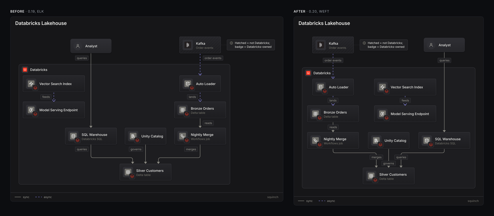
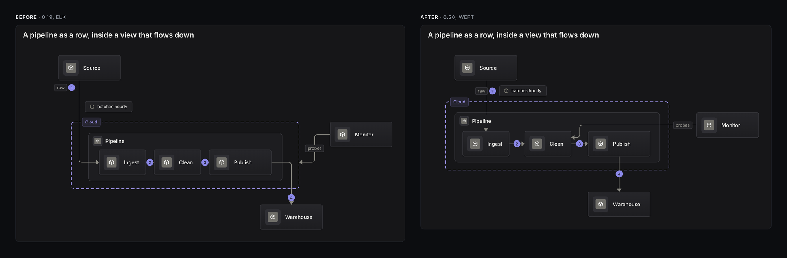
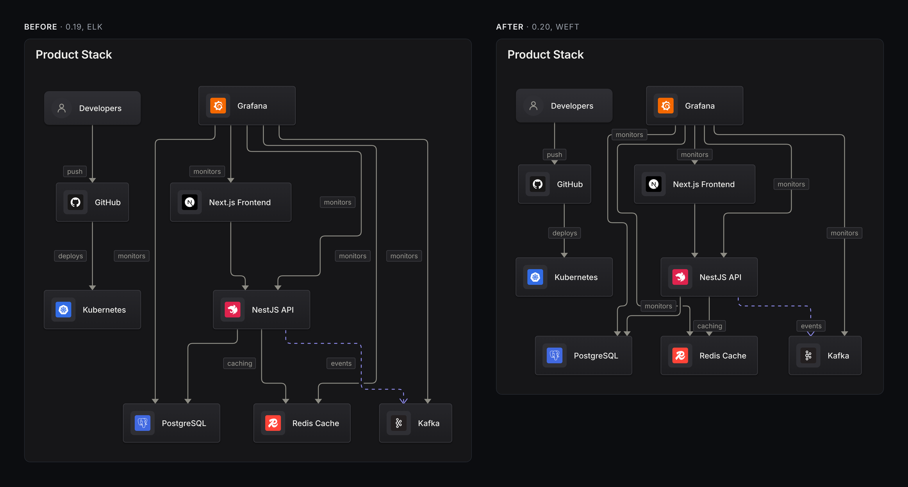
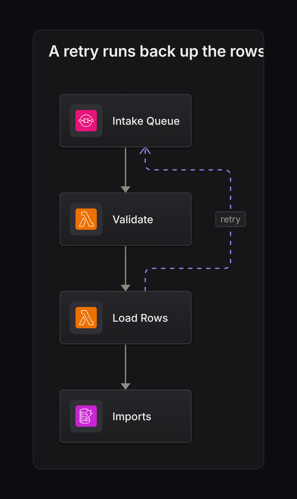

When I [introduced Squinch](/squinch-ai-architecture-diagrams/), I glossed over layout: where every box goes and how every wire gets from one to the other. I'd handed that job to ELK, a well-respected open source graph library, and moved on to the fun stuff.

Over time, most of my layout bugs traced back to working around it. So Squinch 0.20 ships with a layout engine written from scratch for architecture diagrams. It draws a third of the crossings and runs about ten times faster. Most of this post is about how it got built, in case it's useful if you're building something with AI agents too.

*The same source, before and after. Nothing in the diagram's code changed.*
{: .caption}

### What was wrong with the old one

ELK is a layered layout engine. In that model a "layer" is a set of nodes with no edges between them. So if you say "put the API and its cache side by side" and there's a wire between them, ELK can't do it.

I worked around that with a second router for same-row wires, then a third for folded rows, then two clean-up passes for shared trunks and alignment. Each piece worked on its own, and the bugs showed up where they met: a label parked on top of a wire the other router drew, a wire that stopped at a container's edge and never reached the box it named, a row that split in two because of a node nobody listed.

*The source says Monitor probes the Clean stage. The old engine could only get the wire as far as the boundary.*
{: .caption}

A bunch of Squinch's error messages also existed only because the engine couldn't draw what you asked for. An arrow pointing back up your rows, like a retry or a feedback loop, got reported as a "hint conflict" even though it's a perfectly normal thing to draw.

### Four engines to get one

I built this with Claude Code, and it took four tries.

The first engine grew by patching: fix a diagram, find the next ugly one, fix that. It beat ELK, and the code was a pile of special cases. The second tidied the first up and searched harder for good orderings, but it had the same design underneath and the same habits.

So I changed the approach. We wrote down everything we'd learned as a requirements document, about four hundred lines of hard rules, priorities, and descriptions of what a good layout looks like. Then I handed that document to a fresh agent that had never seen the earlier code and wasn't allowed to read it.

That third engine was fast, and it had fewer bends than anything before it. Its diagrams didn't look as good, though.

### The score was wrong, and I only knew by looking

We had a score for every layout: points off for crossings, bends, tiny jogs, and boxes that sit off-centre over the things they connect to. The third engine won on that score by running wires dead straight and leaving boxes hanging lopsided over one child. What a person wants to see is a parent centred over its fan.

I caught it because I'd been looking at every diagram side by side, all 259 of them, old engine on the left and new on the right. The fix was one line in the requirements: balance and symmetry outrank straightness, and a box is never moved to straighten a wire.

A fourth agent, starting cold again from the revised document, wrote the engine that shipped. It's called weft.

### How it's tested

"It looks better to me" doesn't survive the next change, so I spent a lot of time turning that judgment into tests.

- **Hard rules on everything.** No overlapping boxes, no wire through a box it doesn't connect to, no two wires on top of each other, no label sitting on someone else's wire. These are checked on every diagram in the repo, drawn top-to-bottom and again left-to-right.
- **Random diagrams.** Hundreds of generated layouts, including deliberately contradictory hints, are held to the same rules.
- **A quality baseline.** Total crossings, bends and lopsided boxes are recorded, and the build fails if a change makes any of them worse.
- **Cold agents.** Thirty-nine prompts each go to an AI agent that has only the Squinch skill and the CLI. All 39 passed, and for the first time none of them hit a layout error.

Rewriting the old tests for the new engine turned up real bugs. Two aligned boxes on the same row drew on top of each other, and labels on closely spaced wires covered their neighbours in 29 places across the repo. Both were fixed before release and both have tests now.

### What you get

Across the repo's diagrams, crossings went from 73 to 22 and bends from 1,174 to 705. Layout time for the whole set dropped from 2.5 seconds to a quarter of a second.

Alignment is better too. A box sits centred over the things it connects to instead of hanging off to one side, and the whole diagram comes out more balanced.

Several errors no longer exist. An arrow running back up your rows draws. Hints work inside zones. `wrap` folds any wide row, where it used to handle only a single chain or a single fan-out. Every wire ends on the box it names.

*A retry running back up pinned rows. This used to be an error.*
{: .caption}

Layout is never really finished. People throw every kind of diagram at a tool like this, so there's always going to be room to improve. It's a hard problem, even for agents.

### Tips for building with agents

If you're building something similar with agents, here's what I'd pass on:

1. **Write the requirements down, then start over.** The engines that grew by patching were worse than the ones written cold from a document. Most of the value of the first two attempts ended up in that document.
2. **Check the score against your own eyes.** Ours rewarded the wrong thing, and I only found out by looking at the pictures.
3. **Turn "it looks right" into a test** as soon as you believe it, or you'll be arguing about it again in a month.

So yeah, give it a try:


npm i -g squinch


Or poke at it in the [playground](https://squinch.cc/playground/), which is running the new engine now.

Enjoy! =)
